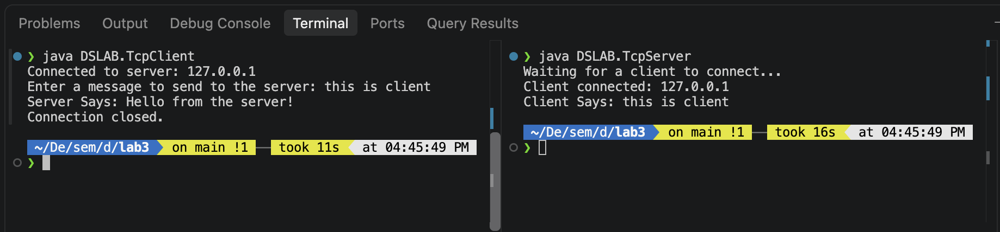

# TCP Socket Client-Server Lab (DSLAB)

This lab demonstrates a simple TCP client-server communication using Java sockets. The server listens on port 5021, accepts a client connection, receives a message, and sends a reply back.

## Socket Concept

A **socket** is an endpoint for communication between two processes over a network. TCP (Transmission Control Protocol) provides a reliable, ordered, and error-checked byte stream between a client and a server.

### How TCP Client-Server Communication Works

1. **Server** creates a `ServerSocket` and binds it to a specific port (e.g., `5021`).
2. The server calls `accept()`, which blocks until a client connects.
3. **Client** creates a `Socket` and connects to the server's IP address and port.
4. Once the connection is established, both sides obtain input and output streams to exchange data.
5. Text is typically sent line-by-line using `PrintWriter.println()` and read with `BufferedReader.readLine()`.
6. The connection is closed when communication is complete.

### Key Java Classes

| Class | Purpose |
|-------|---------|
| `java.net.Socket` | Client-side endpoint that initiates a TCP connection |
| `java.net.ServerSocket` | Server-side listener that waits for incoming client connections |
| `java.io.InputStreamReader` | Converts byte streams to character streams |
| `java.io.BufferedReader` | Reads text efficiently, line by line (`readLine()`) |
| `java.io.PrintWriter` | Writes formatted text to an output stream (`println()`) |

## Project Structure

```text
lab3/
├── readme.md
└── DSLAB/
    ├── TcpServer.java
    ├── TcpClient.java
    ├── TcpServer.class
    └── TcpClient.class
```

Both Java files declare `package DSLAB;`, so they must be compiled and run from the `lab3/` directory (the parent of `DSLAB/`).

## How to Compile and Run

### Prerequisites
- Java Development Kit (JDK) installed

### Step 1: Compile
From the `lab3/` directory:

```bash
javac DSLAB/TcpServer.java DSLAB/TcpClient.java
```

### Step 2: Run the Server
In one terminal:

```bash
java DSLAB.TcpServer
```

Expected output:
```
Waiting for a client to connect...
```

### Step 3: Run the Client
In a second terminal:

```bash
java DSLAB.TcpClient
```

Then type a message when prompted. The server will receive it and reply.

> **Important:** Use dots (`.`) not slashes (`/`) in the class name (`DSLAB.TcpServer`, not `DSLAB/TcpServer`). Always run from `lab3/`, not from inside `DSLAB/`.

## Code Explanation

### `TcpServer.java`

- Creates a `ServerSocket` bound to port `5021`.
- Calls `server.accept()` to wait for an incoming client connection.
- Wraps the socket's input stream in a `BufferedReader` to read the client's message.
- Prints the message received from the client.
- Wraps the socket's output stream in a `PrintWriter` (auto-flush enabled) and sends `"Hello from the server!"`.
- Closes the socket and server socket.

### `TcpClient.java`

- Creates a `Socket` and connects to `localhost` on port `5021`.
- Reads a message from the keyboard using `BufferedReader` wrapped around `System.in`.
- Sends the message to the server using `out.println(message)`.
- Reads the server's reply using `in.readLine()` and prints it.
- Closes the socket.

## Output

The screenshot below shows the server and client output during execution:



### Sample console output

**Server terminal:**
```
Waiting for a client to connect...
Client connected: 127.0.0.1
Client Says: Hello from the client!
```

**Client terminal:**
```
Connected to server: 127.0.0.1
Enter a message to send to the server: Server Says: Hello from the server!
Connection closed.
```

## Key Takeaways

- TCP provides reliable, connection-oriented communication between client and server.
- The server must be started **before** the client; otherwise the client gets `Connection refused`.
- `readLine()` is a blocking call—it pauses execution until a newline-terminated line arrives.
- `PrintWriter` with `autoFlush = true` ensures data is sent immediately over the network.
- Always close sockets to release network resources.

